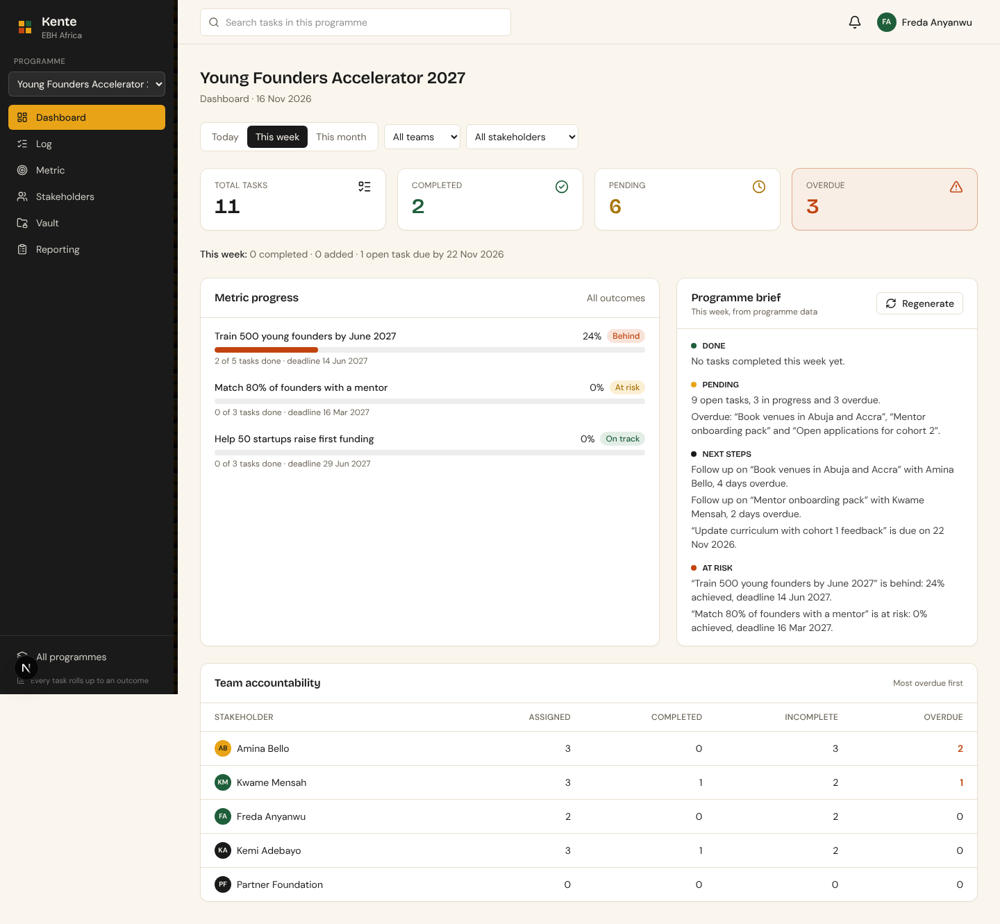

# Kente

Programme and project management for organisations that deliver programmes. Every task is tied to an outcome (a Metric), so daily work rolls up to results.

Requirements: [docs/PRD.md](docs/PRD.md) · Data model and build order: [docs/TECH-SPEC.md](docs/TECH-SPEC.md) · Status: [docs/PROGRESS.md](docs/PROGRESS.md)



## Run locally

```bash
cp .env.example .env.local     # and .env, used by scripts and drizzle-kit
service postgresql start        # or any Postgres 15+
scripts/reset-db.sh kente       # create the database and apply migrations
npm install
npm run db:seed                 # optional demo data (prints the login)
npm run dev
```

Open http://localhost:3000 and create an account. Without Supabase settings, Kente uses built-in local email/password auth (development only).

## Connect Supabase

1. Create a Supabase project. Set `DATABASE_URL` to its session pooler connection string and run `npm run db:migrate`.
2. Set `NEXT_PUBLIC_SUPABASE_URL` and `NEXT_PUBLIC_SUPABASE_ANON_KEY`. Auth then goes through Supabase; the `users` table mirrors `auth.users` by id.
3. Row-level security uses the same `request.jwt.claims` setting Supabase uses, so the policies in `drizzle/0001_rls.sql` apply unchanged.

## Scripts

| Command | What it does |
| --- | --- |
| `npm run dev` | Start the dev server |
| `npm run lint` / `npm run typecheck` | ESLint / TypeScript |
| `npm run test` | Vitest: domain logic and row-level security (database `kente_test`) |
| `npm run test:e2e` | Playwright: builds the app and runs every user flow (database `kente_e2e`) |
| `npm run db:generate` | Generate a migration from `src/db/schema.ts` |
| `npm run db:migrate` | Apply migrations to `DATABASE_URL` |
